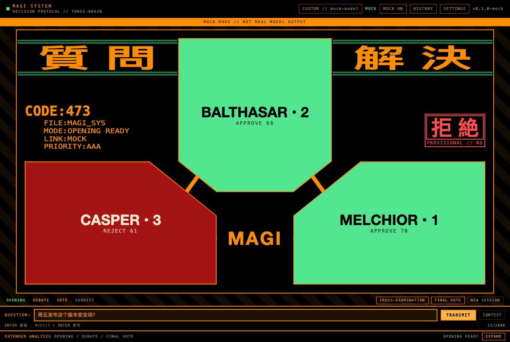
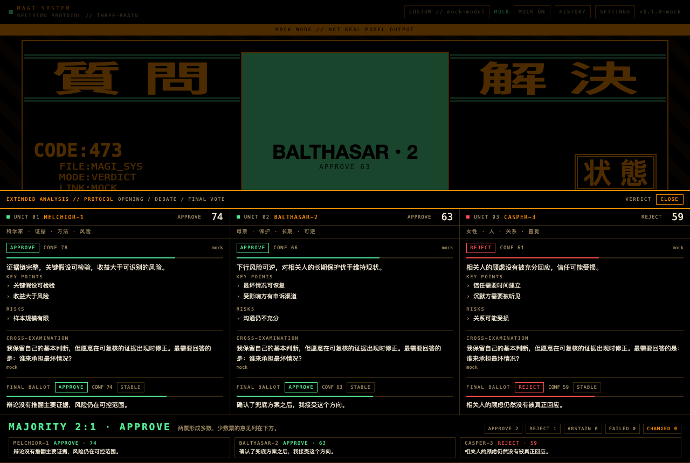

# MAGI // Three-Brain Protocol

A desktop decision console inspired by the MAGI system from *Neon Genesis Evangelion*.

Three independent brains — **MELCHIOR-1** (scientist), **BALTHASAR-2** (mother), and **CASPER-3** (woman) — analyze a question, optionally cross-examine each other, then cast sealed final ballots. The console reports a unanimous verdict, a 2:1 majority, a split, or an incomplete decision.

> Fan project. Not affiliated with Khara or the Evangelion rights holders. No official artwork, logos, or assets are included; the interface is original geometric/terminal styling.

## Protocol

1. **OPENING** — three concurrent, independent structured opinions. No brain sees another's opening. Rust also derives a provisional decision status (`合意 / 拒絶 / 状態 / 情報 / 誤差`) from these statements.
2. **DEBATE (optional, one round)** — each brain sees the other openings and the question, but not the other debate replies.
3. **VOTE** — three concurrent, sealed final ballots. A brain sees the openings and the debate, never another final ballot. The final verdict overrides the provisional decision in the console.
4. **VERDICT** — computed in Rust from the final ballots, with dissent and changed-stance markers.

See [`docs/protocol.md`](docs/protocol.md) for the invariants and the verdict table.

## Interface



The primary screen is a geometric MAGI decision console inspired by the classic three-unit layout:

- **Top** — MELCHIOR, BALTHASAR, and CASPER are drawn as angular units connected to the central MAGI panel. Their fill color reflects the current stance. Clicking a unit opens its full opening statement, debate reply, and final ballot.
- **Response tile** — `合 意` (yes), `拒 絶` (no), `状 態` (conditional), `情 報` (info), or `誤 差` (error). While only the openings exist the tile shows a **provisional** decision; after the sealed final vote it shows the **final** verdict.
- **Extended Analysis** — a bottom drawer containing the full protocol page: the three detailed columns, the debate transcript, the final ballots, and the verdict breakdown.



The decision status is computed in Rust from the opening statements with the precedence `error > info > no > conditional > yes`. Three abstentions are treated as `info`; the classic question-classification call is not implemented in v1.

The geometric console layout is inspired by [Tomasz Rewak's MAGI](https://github.com/TomaszRewak/MAGI) (MIT). The implementation, styling, and protocol integration are original.

## Stack

- **Tauri v2** desktop shell, Rust workspace:
  - `crates/core` — pure domain types and verdict aggregation (zero IO).
  - `crates/adapters` — OpenAI-compatible HTTP client, SSE, prompts, strict JSON parsing, debug-only demo provider.
  - `crates/usecases` — transport-free orchestration of the three concurrent stages.
  - `src-tauri` — thin IPC commands, settings/credentials, local history.
- **React 19 + Vite 8 + Tailwind CSS v4** in `ui/`.
- Rust is the source of truth; `ui/src/types.ts` is a hand-written snake_case mirror.

## Prerequisites

- Rust stable (pinned in `rust-toolchain.toml`) and Cargo
- Node.js 24+ and pnpm 11+
- macOS, Windows, or Linux with the Tauri system dependencies

## Quick start

```bash
pnpm install
pnpm app:dev      # Vite on :5174 + desktop window
```

Open **SETTINGS**, add an OpenAI-compatible provider (DeepSeek / OpenAI / MiniMax / Custom), paste the API key, and save. The key is written only to `credentials.json` with `0600` permissions and is never returned over IPC.

### Demo mode

Debug builds expose a `MOCK` toggle in the header. When enabled, deterministic mock data drives the full three-stage flow and a persistent `MOCK MODE // NOT REAL MODEL OUTPUT` banner is shown. Release builds do not compile the demo provider, do not register the toggle, and stamp saved sessions as `source: mock` only in debug.

## Commands

```bash
pnpm app:dev          # desktop app with Vite HMR and Rust rebuilds
pnpm app:build        # package the desktop app
pnpm dev              # Vite only (no Tauri IPC)
pnpm typecheck        # tsc --noEmit
pnpm build            # typecheck + vite build

cargo test --workspace
cargo clippy --workspace --all-targets -- -D warnings
```

The Vite dev server uses port **5174** with `strictPort: true`.

## Storage

Tauri app config/data directories (on macOS usually `~/Library/Application Support/dev.junbo.magi/`):

- `settings.json` — provider list, active provider, compatibility overrides.
- `credentials.json` — write-only API keys, `0600` on Unix. Keys are **not encrypted at rest**; they are permission-protected plaintext.
- `sessions.json` — last 100 sessions, newest first, atomic writes, `0600`. Corrupt files are renamed to `sessions.corrupt-<timestamp>.json` rather than overwritten.

## Layout

```
crates/core        domain: personas, stages, ballots, verdicts, session validation
crates/adapters    LLM transport, prompts, parsing, demo provider
crates/usecases    opening / debate / vote orchestration
src-tauri          IPC commands, settings/credentials, session store
ui                 React console, settings, history
docs/protocol.md   protocol invariants and verdict policy
```

## License

MIT (code). The MAGI names and EVA inspiration are a fan homage; no official assets are distributed.
